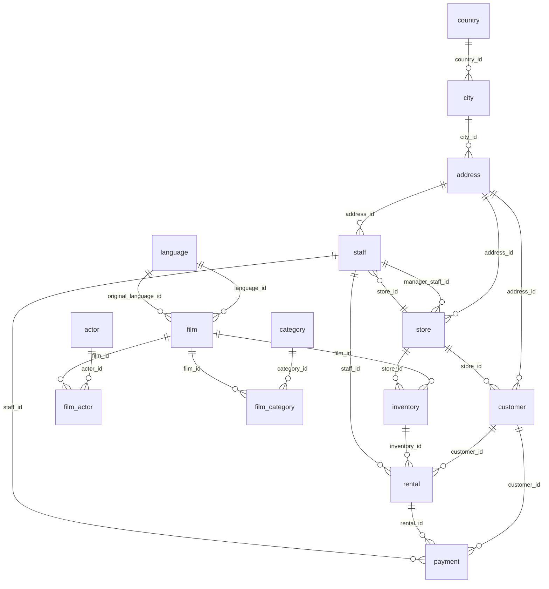

# Esquema de la base de datos

Diagrama de relaciones **extraído de las claves foráneas del archivo SQL original**.

## Tablas del modelo

El esquema `public` define **15 tablas**: `actor`, `category`, `film`, `film_actor`, `film_category`, `address`, `city`, `country`, `customer`, `inventory`, `language`, `payment`, `rental`, `staff`, `store`.

## Relaciones clave

- `film` ↔ `actor` a través de `film_actor` (muchos a muchos).
- `film` ↔ `category` a través de `film_category` (muchos a muchos).
- `film` → `inventory` → `rental` → `payment` permite analizar copias, alquileres e ingresos.
- `customer` → `rental` y `customer` → `payment` permite analizar el comportamiento por cliente.
- `staff`, `store`, `address`, `city` y `country` describen la operación y ubicación.

El fichero fuente contiene además tipos, funciones, índices, triggers y registros de muestra. El diagrama muestra relaciones declaradas como claves foráneas, no todas las dependencias lógicas posibles.
